# Desktop setup and upgrade flows

The popup now checks whether it can attach to Desktop before saying it is
ready. A usable installation that is closed offers **Start JSTorrent**.
**Retry** checks the connection without starting Desktop. When an older
JSTorrent process blocks migration, the popup and companion ask the user
to close the old app and extension pages before retrying.

See [Tactical 402](../../tactical/402-desktop-extension-setup-recovery.md)
for the original feedback, released-build observations, and acceptance plan.

The images in the first three sections are packaged-browser captures made
in bundled Chromium on macOS. The capture runner selects the Windows or
macOS copy and controls the helper replies. Guest results are recorded in
[Verification](#verification).

## Popup with Windows copy

| Before, released extension | After, candidate extension |
| --- | --- |
| 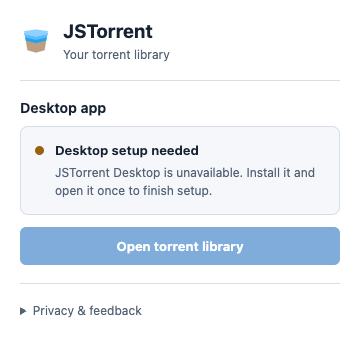 | 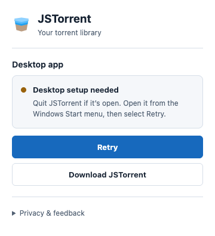 |

Both say **Desktop setup needed** when the native messaging registration
is absent. The released line was “JSTorrent Desktop is unavailable.
Install it and open it once to finish setup.” The candidate says “Quit
JSTorrent if it’s open. Open it from the Windows Start menu, then select
Retry.” It offers **Retry** and **Download JSTorrent**. If Desktop has
registered itself and is closed, the popup says **JSTorrent is closed** and offers
**Start JSTorrent**. [Popup after Retry](04-windows-stopped-after-retry.png)

## Popup with macOS copy

| Setup needed | App moved or missing |
| --- | --- |
| 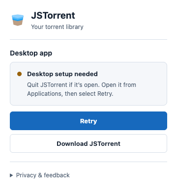 | 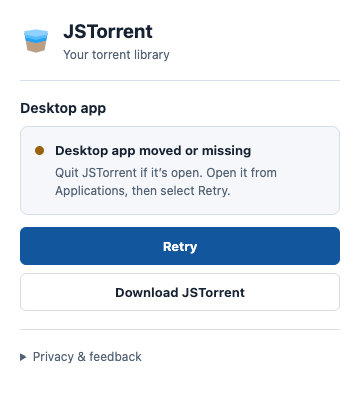 |

Both states say “Quit JSTorrent if it’s open. Open it from Applications,
then select Retry.” The popup offers **Retry** and **Download JSTorrent**.
The moved-app heading appears when Chrome can run the helper but the
helper’s saved Desktop path no longer names an installed bundle. Opening
the intended installed copy repairs that path.

## An older JSTorrent process is still running

| Released extension | Candidate extension |
| --- | --- |
| 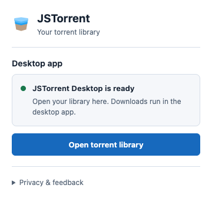 | 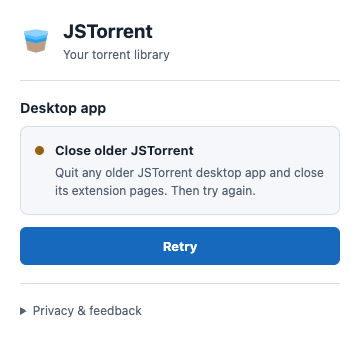 |

The released popup said **JSTorrent Desktop is ready** as soon as its
helper responded, as observed in the [Windows mixed install][baseline].
The candidate says **Close older JSTorrent** and gives this instruction
in both views.

> Quit any older JSTorrent desktop app and close its extension pages. Then try again.

The popup offers **Retry** and the companion offers **Retry connection**.
After the old process exits, Retry can report that Desktop is closed,
and the user can choose **Start JSTorrent**. A successful Start opens
the library tab. The popup says **JSTorrent Desktop is ready** and
“Your desktop library is open in the browser.”

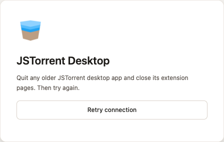

## Windows MSI replacement

The released EXE offered **Do not uninstall** for an existing MSI and
then sent the user to the uninstall prompt anyway. The candidate has a
dedicated **Replace existing JSTorrent** page with the subtitle
**Windows Installer removal is required.**

> Setup found a Windows Installer (MSI) version of JSTorrent. That version must be removed before this setup can continue.
>
> Your torrent library and downloaded files stay on this computer. Windows may ask for administrator approval.
>
> Select Next to open the uninstall prompt, or Cancel to keep the existing installation.

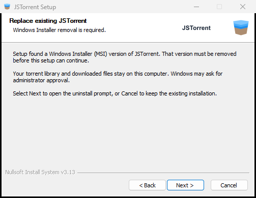

**Next** opens Windows Installer’s “Are you sure you want to uninstall
this product?” confirmation. **No** returns to the replacement page. The
signed 0.2.1 MSI remained installed and the fixture’s legacy rows and
downloaded payload matched their pre-install hashes. **Cancel** closed
the wizard and preserved the same installation and data. When the
administrator approval prompt went unanswered, Setup returned to the
replacement page with the MSI and fixture intact. On retry, granting
approval removed the MSI. Finishing the install launched Desktop, which
imported the fixture torrent as paused with its download folder available.
The source rows and downloaded payload still matched the pre-install hashes.

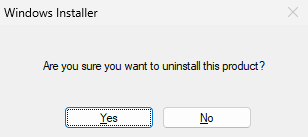

The regular EXE maintenance choices still apply to existing EXE installs.
Production and Preview EXE uninstall remove native messaging registry
entries that point at their own per-user manifests. Production also checks
its retired host registrations in Chrome, Chromium, Brave, and Edge.

## Windows EXE upgrades

With the signed 0.2.1 EXE installed, the candidate shows **Already
Installed** with **Uninstall before installing** and **Do not uninstall**.
With **Do not uninstall** selected, the candidate installed alongside the
older helper and daemon. Running the actual 0.2.1 helper blocked Desktop
before it created a catalog. The popup
showed **Close older JSTorrent** with the instructions above, and a
companion tab on the same browser stayed on **Retry connection**.

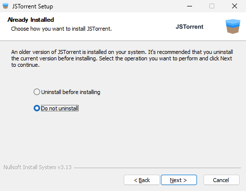

The native migration dialog said “Close JSTorrent desktop and legacy
extension pages, then reopen the updated desktop app. Your legacy data
has been preserved.”

After the helper exited and the migration dialog was dismissed, **Start
JSTorrent** launched Desktop. The candidate extension with the tab
reattachment fix (`6802f01c`) recovered the existing companion tab
without a reload or a second Retry. Desktop again imported the fixture
torrent as paused and preserved the source rows and payload.

**Uninstall before installing** opened the signed legacy EXE’s uninstaller.
**Delete the application data** was unchecked and stayed unchecked. The
old helper, daemon, and installation registration were removed before the
candidate installed. **Finish** launched the candidate, and the same
paused torrent, source rows, and payload were verified afterward.

## Verification

The desktop builds were unsigned candidates from this change, with version
0.3.1 from the checkout. The released Windows baseline used signed Desktop
0.3.12 and legacy 0.2.1 installers. The candidate browser package kept
extension version 1.1.10. The released Windows and candidate macOS browser
runs used Chrome for Testing 158.0.8127.88.

### Windows 11 Pro ARM64, build 26300

The x64 candidate installed in a guest with no existing JSTorrent app,
profile, or browser native messaging keys. Before first launch, Chrome
for Testing showed **Desktop setup needed** and the Windows Start menu
instruction. The installer opened the **Completing JSTorrent Setup** page
with **Run JSTorrent** checked by default. Clicking **Finish** started
Desktop 0.3.1 in the interactive session, wrote the Chrome native
messaging registration, and created the catalog.

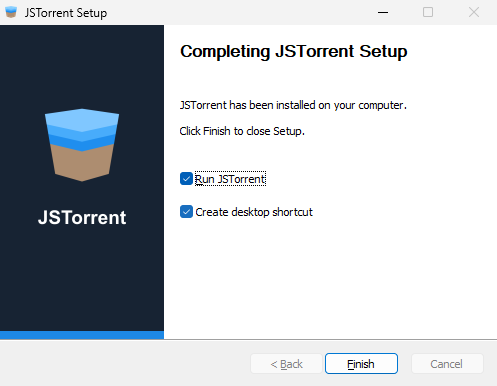

The first attach while the registered app was still starting reported
**JSTorrent is closed** and offered **Start JSTorrent**. A fresh check
after startup showed **JSTorrent Desktop is ready**. Choosing
**Open torrent library** opened the authenticated companion library.
An earlier clean `/S` install also succeeded. The native Windows tests
exercised the control pipe and registration ownership.

The released MSI prompt and released EXE keep-install path were
reproduced in the baseline. The first candidate run lost its desktop
resident and SSH before interactive checks could finish. The clean
wizard, first launch, and browser checks above ran after the guest
recovered. The candidate uninstaller removed its owned Chrome key and
all four owned legacy keys. A foreign Chromium registration and its
manifest were preserved. The imported and source catalogs also survived
uninstall.

Both `/P /R` and `/S /R` launched the registered candidate in the
interactive Windows session after clean installs. The new MSI page is
interactive. The 0.3.1 candidate is older than the released 0.3.12.
Upgrade evidence starts at signed 0.2.1, and unattended launch evidence
covers clean installs. The administrator approval tests used the guest’s
existing account and covered an unanswered prompt and a granted prompt.

After the MSI upgrade, **Open torrent library** focused the existing
companion tab while it still showed the earlier setup failure. **Retry
connection** restored the authenticated view in that tab. The extension
now requests an attach-only retry after a successful popup Start or Open
focuses an existing recovery tab. The packaged Chromium check reproduced
the original failure with the earlier archive and passed with the fix.

After verification, the task’s installs, profiles, browser and staged
files were removed. The Windows claim was released and the inherited
guest stayed running.

### macOS 26.6.2, Apple silicon

Chrome for Testing ran first using a clean profile at its default
`~/Library/Application Support/Google/Chrome for Testing` path. The
candidate showed the Applications instruction before the app was opened.
Opening the installed app wrote the registration into that existing
browser data folder, and the popup attached. After
quitting Desktop and moving the bundle, the popup reported the missing
path. Opening the moved copy and checking again restored attachment.

With the moved copy closed, the actual 0.2.1 helper from the older DMG
produced **Close older JSTorrent** with **Retry**. The helper exited, the
popup showed **JSTorrent is closed**, and an explicit extension start
launched the relocated app and returned an authenticated desktop session.
The macOS run used a clean catalog. A populated legacy catalog import
was verified separately on Windows with the released 0.3.12 desktop
and the 0.3.1 candidate.

### Automated checks

| Check | Result |
| --- | --- |
| Native host tests on macOS | 24 unit and 4 process tests passed |
| Native host clippy and focused Desktop migration tests | Clippy and all 3 migration tests passed |
| Native host x64 unit suite on Windows 11 ARM64 build 26300 | 19 passed under x64 emulation |
| Windows NSIS handler and ownership fixture with native Windows makensis | Passed. Checks all four owned legacy keys, a foreign legacy key, and both directions of Preview and production ownership |
| Desktop release and candidate validators | Both passed, with 29 validator tests |
| Extension | 93 tests passed, production packaging and bundled Chromium CSP check passed |
| Shared web app and companion | Typecheck passed, 983 tests passed and 3 skipped |
| Localization and website | Localization checks passed, 101 website tests passed |
| Formatting | `cargo fmt --all -- --check` passed |

The native host suites include platform-gated tests for their respective
process and control transports.

## Capture method

Screenshots 01–08 use the packaged release and candidate extensions,
both version 1.1.10 and both with the production extension ID. The runner
uses bundled Chromium and a temporary profile. It injects native
responses for closed, moved, and legacy-blocked states. Screenshots 01,
03, and 05 use a real Chrome missing-host error. The runner checks the
exact visible copy and asserts that Retry sends only `attach_control`.
It also verifies that a popup Open first sends `start_control`, followed
by `attach_control` from the existing companion tab.

Screenshots 09–12 are window captures of the live Windows guest. They
show the candidate’s Finish, MSI replacement, and EXE maintenance
pages, plus the native Windows Installer confirmation.

The baseline ZIP is in the `jstorrent-extension-1.1.10` artifact from
[extension release run 42473497821](https://github.com/kzahel/jstorrent/actions/runs/42473497821)
at `69c70860`. Its SHA-256 is
`15050d78e6e4e706ad0d120e5ddd88692865700448f805199bfd1c0d1cd67193`.
Download the release artifact while it is retained, or use the same
production packaging command at the release commit. The runner uses
the `unzip` CLI. These commands capture the current checkout, selecting
the production extension identity and refreshing the report images.

```sh
capture_inputs=$(mktemp -d)
gh run download 42473497821 --repo kzahel/jstorrent \
  --name jstorrent-extension-1.1.10 --dir "$capture_inputs"
npm ci --prefix clients/web
node clients/web/node_modules/playwright-core/cli.js install chromium
npm run package:jstorrent --prefix clients/extension
node scripts/verify-desktop-setup-flows.mjs \
  "$capture_inputs/jstorrent-1.1.10.zip" target/extension/jstorrent-1.1.10.zip \
  docs/evidence/402-desktop-setup
```

[baseline]: ../../tactical/402-desktop-extension-setup-recovery.md#observed-on-windows
